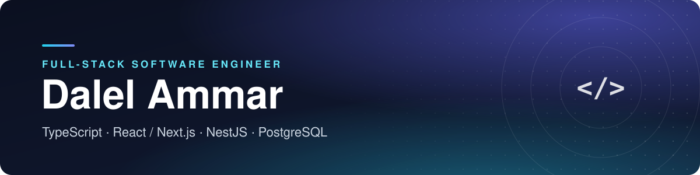

  

  <!-- TODO: check that the LinkedIn URL matches your real profile URL -->
  
  
  <!-- TODO: uncomment and add your portfolio URL
  
  -->

 

## About

I'm a software engineer based in Monastir, Tunisia, with an engineering degree in Software Engineering from ISIMM. I build complete web platforms end to end: APIs, admin dashboards, real-time features, authentication and AI integration.

I work mainly in **TypeScript**, with **Next.js / React** on the front end and **NestJS / Node.js** on the back end, and I care about clean, readable code with clear boundaries.

**Currently open to full-stack developer roles.**

 

## Tech stack

  

**Front end** &nbsp; `TypeScript` `React` `Next.js` `Tailwind CSS` `shadcn/ui` `Material UI`

**Back end** &nbsp; `NestJS` `Node.js` `Express` `REST` `tRPC` `WebRTC` `NextAuth`

**Data** &nbsp; `PostgreSQL` `MySQL` `MongoDB` `Supabase` `Prisma` `Drizzle`

**Tooling** &nbsp; `Git` `GitHub` `GitLab` `Docker` `CI/CD`

**Also** &nbsp; `Python` `Java` `C++` `Figma`

 

## Experience

**Software Engineer Intern, final-year project** · Quicky Prime 
APR – JUN 2026 &nbsp;·&nbsp; SOUSSE

Built an immersive web platform: backend API, admin dashboard, provider dashboard and public site. Delivered user management, 3D scenes, credits, real-time notifications, secure authentication and a conversational AI assistant.

`NestJS` `Next.js` `React` `PostgreSQL` `Prisma` `Supabase` `Tailwind CSS`

---

**Web Developer** · Stravos 
JUL – AUG 2025 &nbsp;·&nbsp; SOUSSE

Built a centralized management platform for advertising banners and carousels.

`Next.js` `tRPC` `PostgreSQL` `Drizzle` `NextAuth` `next-intl`

---

**Web Developer** · Infinity Management 
JUN – SEP 2024 &nbsp;·&nbsp; TUNIS

Built a real-time virtual meeting web app.

`React` `TypeScript` `Express` `WebRTC` `MongoDB`

---

**Freelance Web Developer** · TADA 
2024 &nbsp;·&nbsp; JEMMAL

Built an interactive educational website.

`React` `Node.js` `Express` `MySQL`

---

**Back-End Developer** · ECT 
JUL – AUG 2023 &nbsp;·&nbsp; KSAR HELLAL

Built a company statistics web app.

`Spring Boot` `Oracle`

 

## Selected projects

<!-- TODO: turn each project title into a link to its repository, e.g. <a href="https://github.com/AmmarDalel/your-repo-name"><b>TodoList</b></a> -->

<table>
  <tr>
    <td width="50%" valign="top">
      <b>TodoList (T3 stack)</b>  
      Authenticated task manager with a type-safe API from database to UI.  
      <code>Next.js</code> <code>tRPC</code> <code>Drizzle</code> <code>PostgreSQL</code> <code>NextAuth</code>
    </td>
    <td width="50%" valign="top">
      <b>Personal portfolio</b>  
      Modern, responsive portfolio site.  
      <code>Next.js</code> <code>shadcn/ui</code>
    </td>
  </tr>
  <tr>
    <td width="50%" valign="top">
      <b>ISIMM web app</b>  
      Responsive interface for students and teachers.  
      <code>React</code>
    </td>
    <td width="50%" valign="top">
      <b>Travel agency site</b>  
      Interactive landing page.  
      <code>React</code>
    </td>
  </tr>
</table>

<a href="https://github.com/AmmarDalel?tab=repositories">All repositories →</a>

## Recognition

- **2nd Prize**, Open Challenge, Twise Night (2025)
- **HackerRank certifications:** Frontend Developer (React), JavaScript (Intermediate), REST API (Intermediate), React (Basic)
- Active member of the ARSII association, marketing assistant and designer at Club ARSII ISIMM (2024 – 2025)

 

---

  ARABIC &nbsp;·&nbsp; FRENCH &nbsp;·&nbsp; ENGLISH 
  <a href="mailto:ammardalel07@gmail.com">ammardalel07@gmail.com</a>

